# Evidence screenshots

These are captures of local evidence-review pages. Each caption identifies the original artifact or analysis record.

## Figure 1: Original evidence integrity

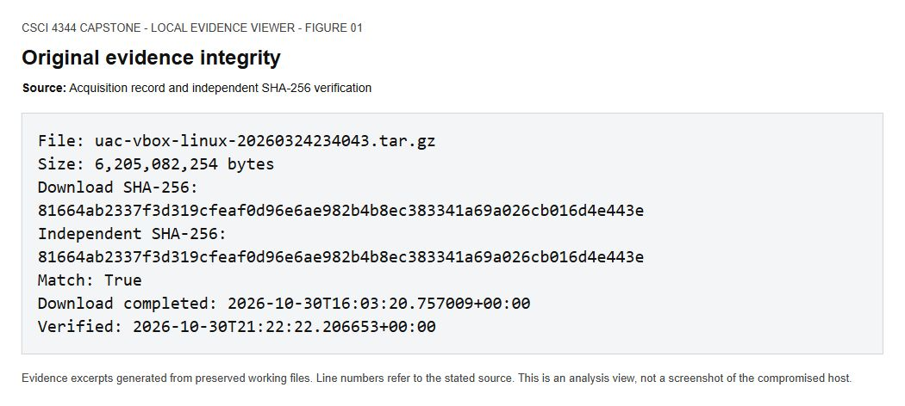

Original archive download hash matches an independent full-file SHA-256 calculation before examination.

Source: `Acquisition record and independent SHA-256 verification`

## Figure 2: Evidence inventory

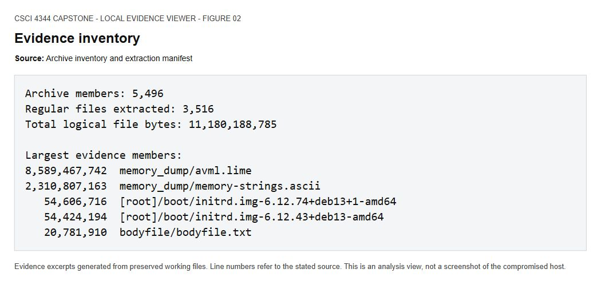

The archive inventory separates memory, supplied strings, Linux files, and metadata before targeted examination.

Source: `Archive inventory and extraction manifest`

## Figure 3: Accounts and privileges

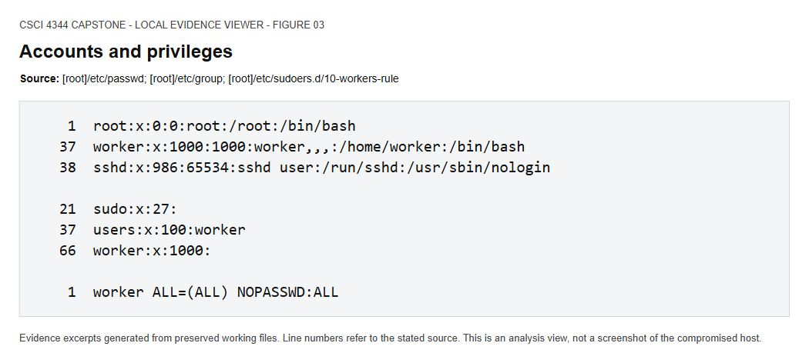

The worker account has UID 1000 and a direct passwordless sudo rule. Its empty sudo-group membership does not remove the separate grant.

Source: `[root]/etc/passwd; [root]/etc/group; [root]/etc/sudoers.d/10-workers-rule`

## Figure 4: Worker authentication and collection session

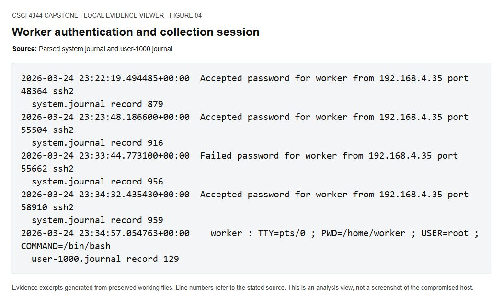

Distinct worker SSH sessions include the later port-58910 session whose process tree launches UAC. Do not automatically classify it as attacker access.

Source: `Parsed system.journal and user-1000.journal`

## Figure 5: Collector process ancestry

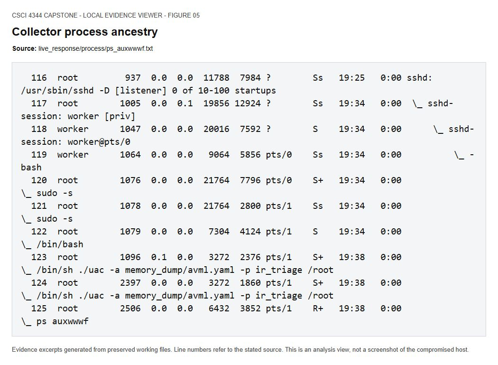

The visible worker SSH session leads through sudo and bash to UAC; this identifies collector-associated privileged activity.

Source: `live_response/process/ps_auxwwwf.txt`

## Figure 6: Processes omitted from ps

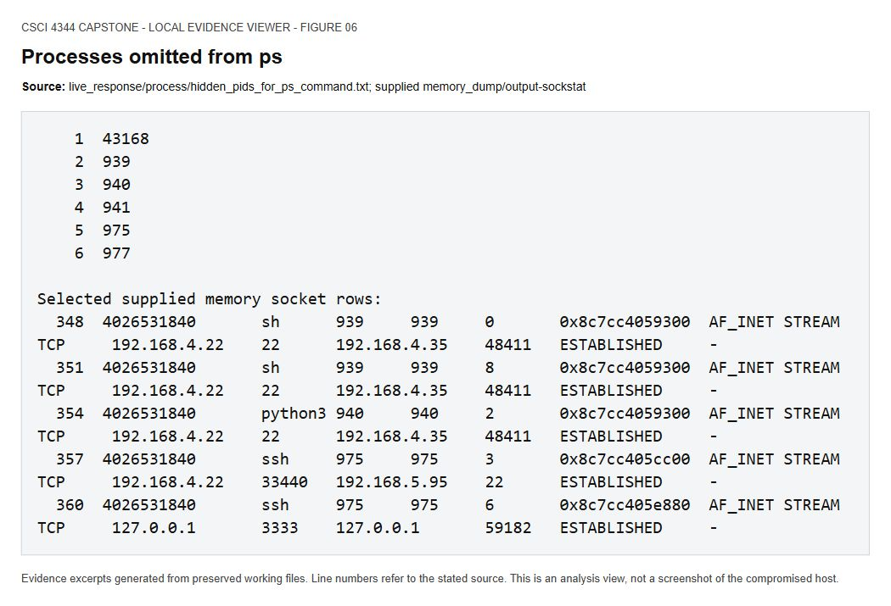

UAC flagged these PIDs as missing from ps. The supplied memory socket output independently lists sh, python3, bash, ssh, and top for the matching IDs; PID 43168 remains uncorroborated.

Source: `live_response/process/hidden_pids_for_ps_command.txt; supplied memory_dump/output-sockstat`

## Figure 7: Dynamic library preload

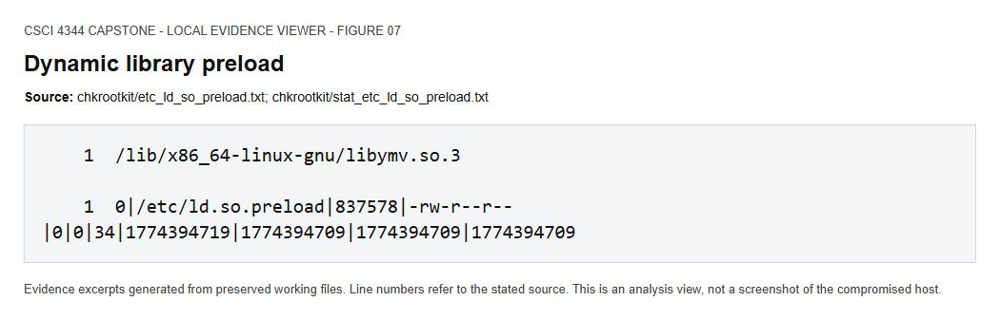

The collector records a global preload reference to libymv.so.3. This is corroborated by the SSH daemon memory map.

Source: `chkrootkit/etc_ld_so_preload.txt; chkrootkit/stat_etc_ld_so_preload.txt`

## Figure 8: Suspicious library mapped in SSH daemon

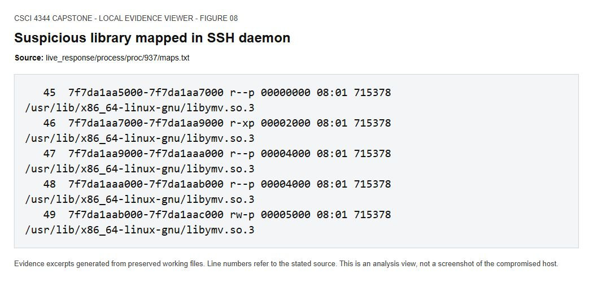

PID 937 maps libymv.so.3 in five regions, corroborating active loading of the library during collection.

Source: `live_response/process/proc/937/maps.txt`

## Figure 9: Commands recovered from raw memory

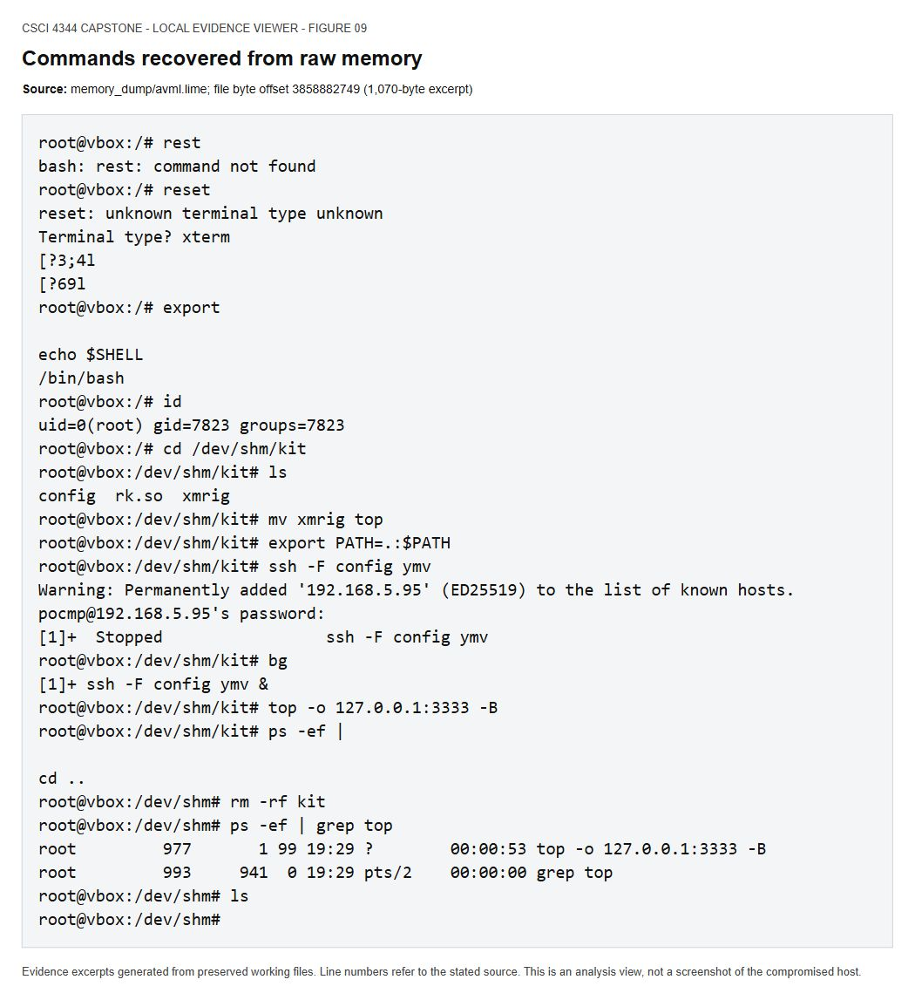

Direct raw-memory excerpt shows UID 0/GID 7823, xmrig renamed to top, an SSH configuration alias, a local mining endpoint, and removal of kit. It is an untimed terminal remnant, not a timestamped audit log.

Source: `memory_dump/avml.lime; file byte offset 3858882749 (1,070-byte excerpt)`

## Figure 10: Python shell evidence verified in raw memory

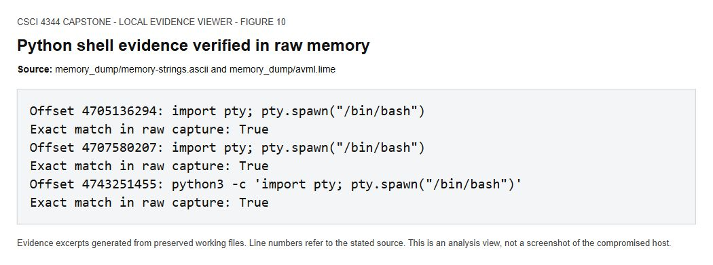

Selected Python PTY strings were verified against the raw memory bytes at the offsets reported in the supplied strings file.

Source: `memory_dump/memory-strings.ascii and memory_dump/avml.lime`

## Figure 11: Shell socket on TCP port 22

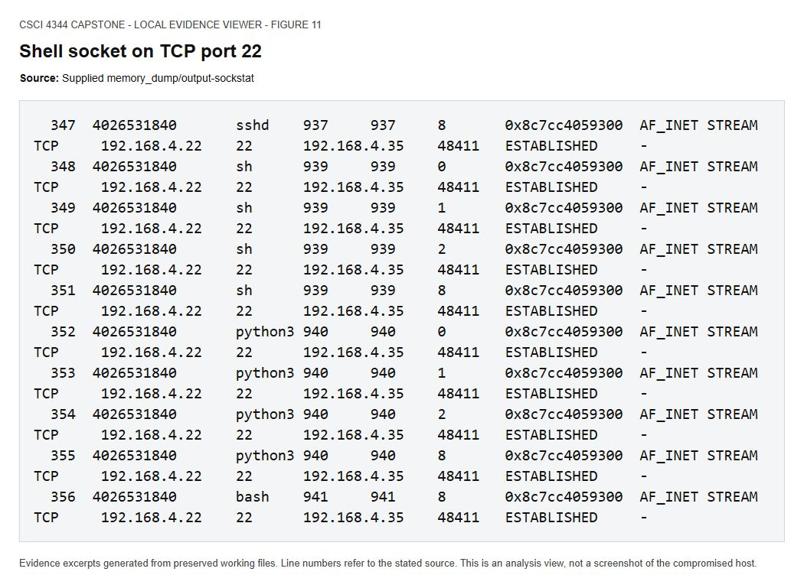

The supplied socket table associates the same kernel socket with sshd, sh, python3, and bash on the .35:48411 connection. TCP/22 alone does not prove an authenticated SSH session.

Source: `Supplied memory_dump/output-sockstat`

## Figure 12: Miner connection and SSH forwarding

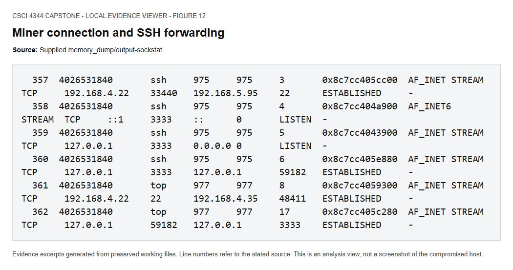

SSH PID 975 connects to 192.168.5.95:22 and listens on loopback port 3333. Top PID 977 connects to that loopback listener, consistent with the recovered launch command.

Source: `Supplied memory_dump/output-sockstat`

## Figure 13: Preload failures during an earlier boot

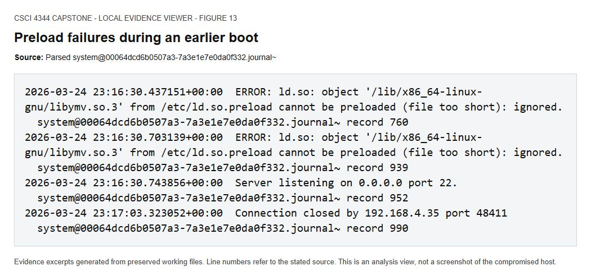

The earlier boot logs repeated preload failures because the library was too short. Later mapped-library evidence must be assessed separately from these earlier errors.

Source: `Parsed system@00064dcd6b0507a3-7a3e1e7e0da0f332.journal~`

## Figure 14: Suspicious library metadata and recorded hash

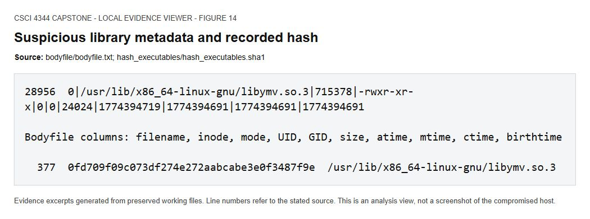

The library has size 24,024 bytes and a collector-recorded SHA-1. Its file contents were not separately collected, so a full-file SHA-256 is not asserted.

Source: `bodyfile/bodyfile.txt; hash_executables/hash_executables.sha1`

## Figure 15: Persistence checks: cron and startup files

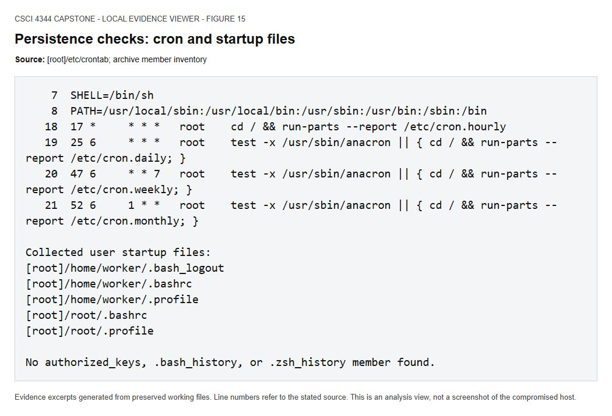

Cron shows standard maintenance jobs. Missing history/key files are collection absences and do not by themselves establish deletion or absence on the source host.

Source: `[root]/etc/crontab; archive member inventory`

## Figure 16: Host time and forensic collection

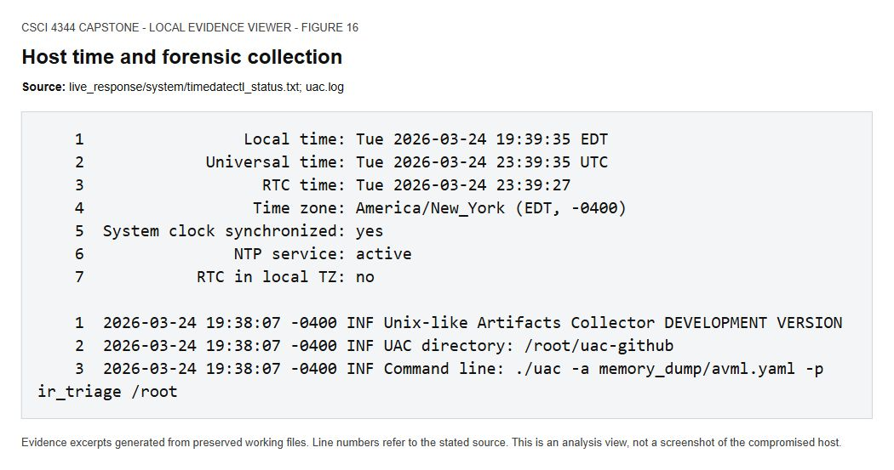

The host reports EDT (UTC-04:00); report timelines normalize to UTC. UAC identifies itself as a development version and uses the ir_triage profile plus AVML.

Source: `live_response/system/timedatectl_status.txt; uac.log`